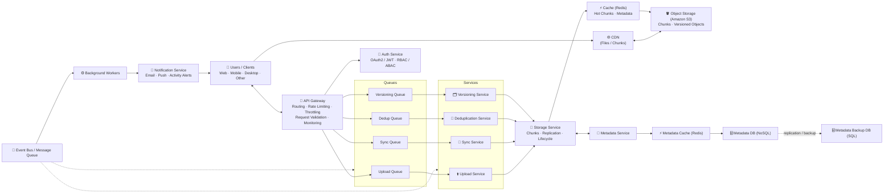
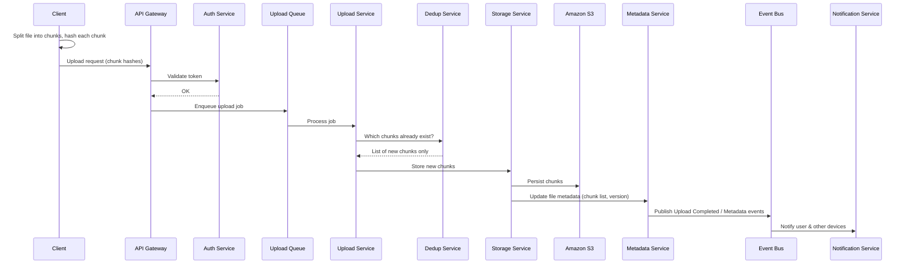

# ☁️ Cloud Storage Platform — System Design

A scalable, fault-tolerant cloud file storage and sync platform (in the spirit of Dropbox / Google Drive). Files are split into chunks, deduplicated, versioned, synced across devices in real time, and stored durably in object storage, with heavy work handled asynchronously through queues, an event bus and background workers.

---

## 📑 Table of Contents

- [Overview](#-overview)
- [Architecture Diagram](#-architecture-diagram)
- [Core Components](#-core-components)
- [Request Flows](#-request-flows)
- [Data Model](#-data-model)
- [Tech Stack](#-tech-stack)
- [Scalability & Reliability](#-scalability--reliability)
- [Security](#-security)
- [Key Design Decisions](#-key-design-decisions)
- [Future Improvements](#-future-improvements)

---

## 🔭 Overview

| Goal | How it's achieved |
|---|---|
| Upload/download large files reliably | Chunking + resumable uploads, CDN for downloads |
| Keep devices in sync | Sync Service with real-time change notifications |
| Save storage cost | Content-hash based chunk deduplication |
| Recover previous file states | Versioning Service with versioned objects in S3 |
| Low latency reads | Redis caches for hot chunks and metadata, CDN at the edge |
| High durability | Amazon S3 + replication + SQL backup of metadata |
| Absorb traffic spikes | Per-domain queues, event bus and background workers |

---

## 🗺️ Architecture Diagram



---

## 🧩 Core Components

### 1. Clients
Web, mobile, desktop and other devices. Clients split files into chunks locally, compute chunk hashes, upload only changed chunks, and download content through the CDN.

### 2. CDN (Files / Chunks)
Serves file chunks from edge locations close to the user. Pulls from Amazon S3 on a cache miss, cutting download latency and origin load.

### 3. API Gateway
Single entry point for all client requests.
- **Routing** to the right queue or service
- **Rate limiting & throttling** per user / per API key
- **Request validation** (schema, size limits)
- **Monitoring** — logs, metrics, tracing

### 4. Auth Service
- **Authentication:** OAuth2 / JWT
- **Authorization:** RBAC (roles) and ABAC (attribute-based rules, e.g. shared-folder permissions)
- **Token validation** for every request passing the gateway

### 5. Queues
Each domain gets its own queue so a burst in one (e.g. bulk uploads) doesn't starve the others.

| Queue | Carries |
|---|---|
| Upload Queue | File upload jobs |
| Sync Queue | Device sync jobs |
| Dedup Queue | Chunk dedup checks |
| Versioning Queue | Version events |

### 6. Domain Services

| Service | Responsibility |
|---|---|
| **Upload Service** | Chunking, resumable uploads, validating and storing chunks |
| **Sync Service** | Real-time sync, notifying a user's other devices of changes |
| **Deduplication Service** | Detects duplicate chunks by hash and stores each unique chunk once |
| **Versioning Service** | Preserves previous versions and maintains version metadata |

### 7. Storage Service
Abstraction over physical storage: stores file chunks, handles replication, applies lifecycle policies (e.g. move old versions to cheaper tiers) and guarantees high durability.

### 8. Cache (Redis)
Keeps **hot file chunks** and a **metadata cache** in memory for frequently accessed content.

### 9. Object Storage (Amazon S3)
Source of truth for file content: chunks, durability (11 nines), and versioned objects.

### 10. Metadata Service
Manages file/folder metadata — owners, permissions, size, timestamps, chunk lists and version pointers.

- **Metadata Cache (Redis):** fast access to hot metadata
- **Metadata DB (NoSQL):** primary, horizontally scalable metadata store
- **Metadata Backup DB (SQL):** replicated backup for recovery, auditing and relational reporting

### 11. Event Bus / Message Queue
Asynchronous backbone carrying domain events:
`Upload Completed` · `Sync` · `Dedup` · `Versioning` · `Metadata`

### 12. Background Workers
Consume events and do the heavy lifting off the request path: Upload, Sync, Dedup, Versioning and Metadata workers.

### 13. Notification Service
Sends email and push notifications, share invitations and activity alerts back to users.

---

## 🔁 Request Flows

### Upload a file



1. Client chunks the file (e.g. 4 MB chunks) and hashes each chunk (SHA-256).
2. Request passes the API Gateway and is authenticated by the Auth Service.
3. Job is placed on the **Upload Queue**.
4. Upload Service asks the Deduplication Service which chunks are new.
5. Only new chunks are uploaded; interrupted uploads **resume** from the last stored chunk.
6. Storage Service writes to S3 and updates metadata.
7. An `Upload Completed` event triggers sync, versioning and notifications.

### Download a file
1. Client requests file metadata (chunk list) via the API Gateway.
2. Metadata is served from Redis, falling back to the Metadata DB.
3. Client fetches chunks from the **CDN** → Redis hot cache → S3.
4. Client reassembles the file locally.

### Sync across devices
1. A change on one device produces a **Sync event**.
2. Sync Service and Sync Workers determine affected devices.
3. Other devices are notified (push / long polling / WebSocket) and pull only the changed chunks.

### Restore a previous version
1. Client requests a file's version history from the Metadata Service.
2. Versioning Service resolves the chunk list for the chosen version.
3. Chunks are served from S3 versioned objects; the restored version becomes the latest.

---

## 🗃️ Data Model

**File metadata (NoSQL)**
```json
{
  "fileId": "f_123",
  "ownerId": "u_42",
  "name": "report.pdf",
  "parentFolderId": "d_7",
  "size": 10485760,
  "latestVersion": 3,
  "permissions": [{ "userId": "u_99", "role": "viewer" }],
  "createdAt": "2026-10-21T10:00:00Z",
  "updatedAt": "2026-10-21T12:30:00Z"
}
```

**File version**
```json
{
  "fileId": "f_123",
  "version": 3,
  "chunks": ["sha256:ab12...", "sha256:cd34...", "sha256:ef56..."],
  "createdBy": "u_42",
  "createdAt": "2026-10-21T12:30:00Z"
}
```

**Chunk**
```json
{
  "chunkHash": "sha256:ab12...",
  "s3Key": "chunks/ab/12/ab12...",
  "size": 4194304,
  "refCount": 17
}
```

`refCount` lets dedup safely garbage-collect a chunk once no file version references it.

---

## 🛠️ Tech Stack

| Layer | Technology (suggested) |
|---|---|
| Clients | React / Next.js (web), React Native (mobile), Electron (desktop) |
| API Gateway | AWS API Gateway / Kong / NGINX |
| Services | Node.js / Python (FastAPI) microservices |
| Auth | OAuth2, JWT, RBAC/ABAC policy engine |
| Queues & Event Bus | Kafka / RabbitMQ / AWS SQS + SNS |
| Cache | Redis |
| Object Storage | Amazon S3 (with versioning + lifecycle rules) |
| Metadata DB | MongoDB / DynamoDB / Cassandra |
| Metadata Backup | PostgreSQL / MySQL |
| CDN | CloudFront / Cloudflare |
| Notifications | FCM / APNs (push), SES / SendGrid (email) |
| Observability | Prometheus, Grafana, OpenTelemetry, ELK |

---

## 📈 Scalability & Reliability

- **Stateless services** behind the gateway scale horizontally.
- **Queues decouple** ingestion from processing and absorb traffic spikes.
- **Metadata sharding** by `userId` / `fileId` in the NoSQL DB.
- **Multi-layer caching:** CDN → Redis → S3.
- **Durability:** S3 replication, plus metadata replicated to a SQL backup DB.
- **Retries & dead-letter queues** for failed background jobs.
- **Idempotent chunk writes** — the content hash is the key, so re-uploads are safe.
- **Lifecycle policies** move cold data and old versions to cheaper tiers (S3 IA / Glacier).

---

## 🔒 Security

- OAuth2 / JWT authentication validated at the gateway
- RBAC + ABAC for owner, editor, viewer and shared-link permissions
- TLS in transit; server-side encryption (SSE-KMS) at rest
- Signed, expiring CDN / S3 URLs for downloads
- Rate limiting and throttling against abuse
- Audit trail through metadata events

---

## ⚖️ Key Design Decisions

| Decision | Why |
|---|---|
| **Chunking** | Resumable uploads, parallel transfer, and syncing only changed parts of large files |
| **Content-hash dedup** | Identical chunks across files/users are stored once, cutting storage cost |
| **Separate queues per domain** | Isolates workloads so one spike doesn't block the others |
| **Event-driven workers** | Keeps the request path fast; heavy work runs asynchronously |
| **NoSQL for metadata** | High write throughput and easy horizontal scaling |
| **SQL backup** | Strong consistency for recovery, audits and reporting |
| **CDN for downloads** | Lower latency and reduced load on origin storage |

---

## 🚀 Future Improvements

- Client-side end-to-end encryption
- Delta sync within chunks (rsync-style rolling hashes)
- Conflict resolution UI for concurrent edits
- Full-text search across documents
- Multi-region active-active deployment
- Malware scanning on upload
- Storage quota and usage analytics dashboard

---

## 📄 License

MIT
