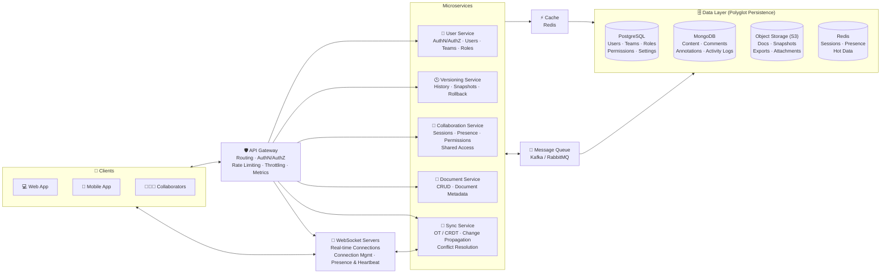
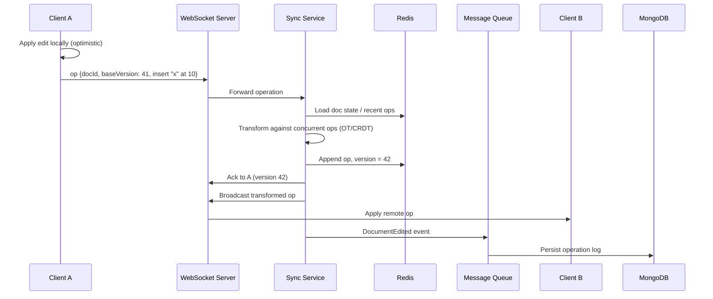

# 📝 Collaborative Document Editor — System Design

A real-time collaborative document editor (in the spirit of Google Docs / Notion). Several people can edit the same document at once and see each other's cursors and changes within milliseconds. Edits are merged without conflicts using Operational Transform / CRDTs, full version history supports rollback, and data is stored across purpose-fit databases (polyglot persistence).

---

## 📑 Table of Contents

- [Overview](#-overview)
- [Architecture Diagram](#-architecture-diagram)
- [Core Components](#-core-components)
- [Data Layer (Polyglot Persistence)](#-data-layer-polyglot-persistence)
- [Request Flows](#-request-flows)
- [Conflict Resolution: OT vs CRDT](#-conflict-resolution-ot-vs-crdt)
- [Data Model](#-data-model)
- [API Overview](#-api-overview)
- [WebSocket Events](#-websocket-events)
- [Tech Stack](#-tech-stack)
- [Scalability & Reliability](#-scalability--reliability)
- [Security](#-security)
- [Key Design Decisions](#-key-design-decisions)
- [Future Improvements](#-future-improvements)

---

## 🔭 Overview

| Goal | How it's achieved |
|---|---|
| Many users editing the same doc at once | Sync Service with Operational Transform / CRDT |
| Sub-second visibility of edits | Persistent WebSocket connections |
| See who's in the doc and where | Presence, cursors and heartbeats via WebSocket servers + Redis |
| Never lose work | Operation log, periodic snapshots, version history and rollback |
| Fine-grained sharing | Collaboration Service (permissions, shared access) + User Service (teams, roles) |
| Fast document loads | Redis cache for hot documents and sessions |
| Loose coupling and async work | Message queue (Kafka / RabbitMQ) between services |
| Right storage for each kind of data | PostgreSQL, MongoDB, S3 and Redis |

---

## 🗺️ Architecture Diagram



---

## 🧩 Core Components

### 1. Clients
- **Web App** and **Mobile App** — the editor UI, with a local copy of the document and an operation buffer so typing feels instant.
- **Collaborators** — other users in the same document, each with their own live connection.

### 2. API Gateway
Entry point for REST traffic (opening docs, sharing, history, exports).
- **Routing** to the right service
- **AuthN / AuthZ** — JWT / OAuth validation and permission checks
- **Rate limiting** and **request throttling**
- **Metrics** — latency, errors, throughput

### 3. WebSocket Servers
Hold long-lived connections for real-time editing.
- **Real-time connections** — edits and cursor moves flow both ways
- **Connection management** — reconnects, routing a user to the server that handles their document
- **Presence & heartbeat** — who's online, idle or disconnected

### 4. User Service
Authentication, authorization, users, teams and roles (owner, editor, commenter, viewer).

### 5. Versioning Service
- Document history (who changed what and when)
- **Snapshots** taken periodically or after N operations
- **Rollback & recovery** to any earlier version

### 6. Collaboration Service
- Editing **sessions** per document
- **Presence** (active users, cursor colors, selections)
- **Permissions** and **shared access management** (invite by email, link sharing, access levels)

### 7. Document Service
Create, read, update and delete documents, plus document metadata (title, owner, folder, timestamps).

### 8. Sync Service
The real-time engine.
- **Operational Transform / CRDT** to merge concurrent edits
- **Change propagation** — broadcasts accepted operations to every collaborator in the doc
- **Conflict resolution** — guarantees every client converges to the same document state

### 9. Cache (Redis)
Hot documents, recent operations, permission lookups and session data for fast reads.

### 10. Message Queue (Kafka / RabbitMQ)
Carries events such as `DocumentEdited`, `SnapshotRequested`, `DocumentShared` and `CommentAdded`. Consumers persist operations, create snapshots, write activity logs, send notifications and update search, all off the editing path.

---

## 🗄️ Data Layer (Polyglot Persistence)

| Store | Holds | Why this store |
|---|---|---|
| **PostgreSQL** | Users, teams, roles, permissions, settings | Relational data with strong consistency and joins |
| **MongoDB** | Document content, comments, annotations, activity logs | Flexible, nested, document-shaped data |
| **Object Storage (S3)** | Documents, snapshots, exported files (PDF/DOCX), attachments | Cheap, durable storage for large blobs |
| **Redis** | Active sessions, presence, frequently accessed data | In-memory speed for ephemeral, high-churn data |

---

## 🔁 Request Flows

### Open a document

1. Client calls `GET /documents/{id}` through the API Gateway.
2. Collaboration Service checks the user's permission (Redis, then PostgreSQL).
3. Document Service loads the latest snapshot plus operations since that snapshot (Redis → MongoDB / S3).
4. Client opens a WebSocket connection and joins the document's session.
5. Presence is updated and other collaborators see the new user.

### Real-time edit



1. The user types; the change is applied locally right away for instant feedback.
2. The operation is sent with the **base version** it was made against.
3. The Sync Service transforms it against any concurrent operations, assigns the next version and stores it.
4. The author gets an ack; all other collaborators receive the transformed operation.
5. The operation is persisted asynchronously through the message queue.

### Presence and cursors
1. Clients send cursor positions and heartbeats over WebSocket.
2. Presence is stored in Redis with a short TTL.
3. Updates are broadcast to everyone in the session; a missed heartbeat marks the user offline.

### Version history and rollback
1. After every N operations (or a time interval), the Versioning Service writes a **snapshot** to S3.
2. History shows snapshots plus named versions.
3. Rollback loads a snapshot and creates a **new** version from it, so no history is lost.

### Offline editing
1. Client queues operations locally while offline.
2. On reconnect, queued operations are sent with their base version.
3. The Sync Service transforms and merges them like any other concurrent edits.

---

## ⚔️ Conflict Resolution: OT vs CRDT

| | Operational Transform (OT) | CRDT |
|---|---|---|
| **Idea** | Transform incoming ops against concurrent ops on a central server | Data structure guarantees merges commute; no central ordering needed |
| **Server role** | Central authority orders operations | Server mainly relays and persists |
| **Offline / P2P** | Harder | Natural fit |
| **Metadata overhead** | Low | Higher (unique IDs per character / element) |
| **Used by** | Google Docs | Figma-style tools, Yjs, Automerge |

**Example (OT):** the document is `"Helo"`. A inserts `"l"` at index 3 and B inserts `"!"` at index 4 at the same moment. The server applies A's op first, then shifts B's index to 5. Both clients end up with `"Hello!"`.

---

## 🗃️ Data Model

**Document metadata (PostgreSQL / MongoDB)**
```json
{
  "docId": "doc_123",
  "title": "System Design Notes",
  "ownerId": "u_42",
  "folderId": "f_7",
  "currentVersion": 42,
  "latestSnapshotVersion": 40,
  "createdAt": "2026-10-23T10:00:00Z",
  "updatedAt": "2026-10-23T17:55:00Z"
}
```

**Operation (MongoDB operation log)**
```json
{
  "docId": "doc_123",
  "version": 42,
  "userId": "u_42",
  "op": { "type": "insert", "pos": 10, "text": "x" },
  "baseVersion": 41,
  "timestamp": "2026-10-23T17:55:01Z"
}
```

**Permission (PostgreSQL)**
```json
{
  "docId": "doc_123",
  "principal": { "type": "user", "id": "u_99" },
  "role": "EDITOR",
  "grantedBy": "u_42"
}
```

**Snapshot (S3)**
```json
{
  "docId": "doc_123",
  "version": 40,
  "s3Key": "snapshots/doc_123/v40.json",
  "createdAt": "2026-10-23T17:50:00Z"
}
```

**Presence (Redis, TTL 30s)**
```json
{
  "docId": "doc_123",
  "userId": "u_99",
  "cursor": { "pos": 128, "selectionEnd": 140 },
  "color": "#E91E63",
  "lastSeen": "2026-10-23T17:55:02Z"
}
```

---

## 🔌 API Overview

| Method | Endpoint | Service | Description |
|---|---|---|---|
| `POST` | `/auth/login` | User | Log in, returns JWT |
| `POST` | `/documents` | Document | Create a document |
| `GET` | `/documents/{id}` | Document | Load document (snapshot + ops) |
| `PATCH` | `/documents/{id}` | Document | Rename / update metadata |
| `DELETE` | `/documents/{id}` | Document | Delete (move to trash) |
| `POST` | `/documents/{id}/share` | Collaboration | Share with users / generate link |
| `GET` | `/documents/{id}/collaborators` | Collaboration | List collaborators and roles |
| `GET` | `/documents/{id}/versions` | Versioning | Version history |
| `POST` | `/documents/{id}/versions/{v}/restore` | Versioning | Roll back to a version |
| `POST` | `/documents/{id}/comments` | Document | Add comment / annotation |
| `POST` | `/documents/{id}/export?format=pdf` | Document | Export to PDF / DOCX |

---

## 📡 WebSocket Events

| Event | Direction | Payload |
|---|---|---|
| `doc.join` | Client → Server | `{ docId }` |
| `doc.op` | Client → Server | `{ docId, baseVersion, op }` |
| `doc.ack` | Server → Client | `{ version }` |
| `doc.remote_op` | Server → Clients | `{ version, userId, op }` |
| `presence.update` | Both | `{ userId, cursor, selection }` |
| `presence.leave` | Server → Clients | `{ userId }` |
| `heartbeat` | Client → Server | `{ ts }` |

---

## 🛠️ Tech Stack

| Layer | Technology (suggested) |
|---|---|
| Web client | React / Next.js, ProseMirror / Slate / TipTap editor |
| Mobile client | React Native / Flutter |
| API Gateway | Kong / NGINX / AWS API Gateway |
| Real-time | WebSocket servers (ws / Socket.IO), Redis Pub/Sub |
| Sync engine | OT (ShareDB) or CRDT (Yjs / Automerge) |
| Services | Node.js / Python (FastAPI) / Go microservices |
| Message Queue | Kafka / RabbitMQ |
| Structured data | PostgreSQL |
| Document data | MongoDB |
| Blobs & snapshots | Amazon S3 |
| Cache & sessions | Redis |
| Deployment | Docker, Kubernetes |
| Observability | Prometheus, Grafana, OpenTelemetry, ELK |

---

## 📈 Scalability & Reliability

- **Document-based sharding:** all collaborators on a document are routed (consistent hashing on `docId`) to the same Sync Service instance, so ordering stays simple and fast.
- **Horizontally scaled WebSocket servers** with Redis Pub/Sub to fan out messages across servers.
- **Snapshots + operation log:** documents load from the latest snapshot plus a short tail of operations instead of replaying full history.
- **Log compaction:** old operations are folded into snapshots and archived to S3.
- **Async persistence** through the message queue keeps the edit path fast.
- **Optimistic local edits** hide network latency from users.
- **Reconnect and resync:** clients resend unacknowledged ops with their base version after a dropped connection.
- **Idempotent operations** (unique op IDs) so retries never apply an edit twice.
- **Multi-AZ deployment** and database replicas for availability.

---

## 🔒 Security

- JWT / OAuth authentication at the API Gateway and on WebSocket handshake
- Role-based access per document: owner, editor, commenter, viewer
- Permission checked on every operation, not just on open
- Expiring, revocable share links
- Rate limiting and throttling against abusive clients
- TLS for HTTPS and WSS; encryption at rest for databases and S3
- Audit trail through activity logs

---

## ⚖️ Key Design Decisions

| Decision | Why |
|---|---|
| **WebSockets for editing** | Edits and cursors need low-latency, two-way push |
| **OT / CRDT** | Concurrent edits merge deterministically; everyone converges to the same text |
| **Separate Sync Service** | The real-time path scales and evolves independently of CRUD |
| **Snapshots + op log** | Fast loads, full history and cheap rollback |
| **Polyglot persistence** | Each kind of data goes in the store that fits it best |
| **Redis for presence** | Presence is ephemeral and changes constantly |
| **Message queue** | Persistence, logging and notifications never slow down typing |
| **Optimistic UI** | Typing feels instant even on slow networks |

---

## 🚀 Future Improvements

- Suggestion mode (tracked changes) and threaded comment resolution
- Full-text search across documents
- Rich embeds: tables, images, drawings, code blocks
- Offline-first mode with full CRDT sync
- AI writing assistance and summaries
- Templates and document workspaces
- Import / export for DOCX, Markdown and PDF
- End-to-end encryption for sensitive documents

---

## 📄 License

MIT
