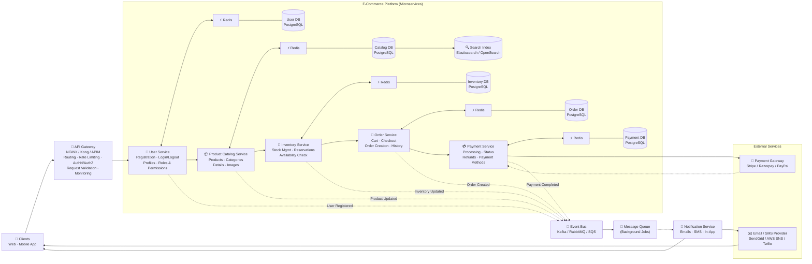
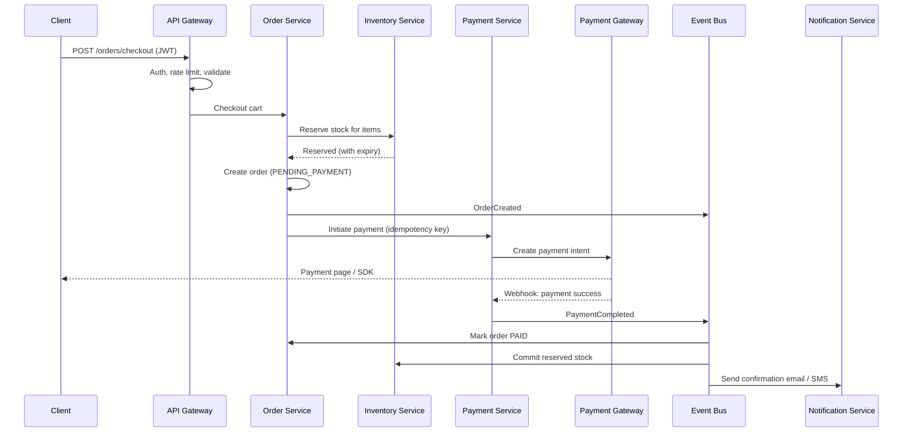

# 🛒 E-Commerce Platform — System Design

A scalable, microservices-based e-commerce platform (in the spirit of Amazon / Flipkart). Each business domain — users, catalog, inventory, orders and payments — is an independent service with its own Redis cache and PostgreSQL database. Services publish domain events to an event bus, which drives background jobs and customer notifications asynchronously.

---

## 📑 Table of Contents

- [Overview](#-overview)
- [Architecture Diagram](#-architecture-diagram)
- [Core Components](#-core-components)
- [Domain Events](#-domain-events)
- [Request Flows](#-request-flows)
- [Data Model](#-data-model)
- [API Overview](#-api-overview)
- [Tech Stack](#-tech-stack)
- [Scalability & Reliability](#-scalability--reliability)
- [Security](#-security)
- [Key Design Decisions](#-key-design-decisions)
- [Future Improvements](#-future-improvements)

---

## 🔭 Overview

| Goal | How it's achieved |
|---|---|
| Independent development and scaling | Microservices with a database per service |
| Single, secure entry point | API Gateway (NGINX / Kong / APIM) |
| Fast reads for hot data | Redis cache in front of every service database |
| Rich product search | Elasticsearch / OpenSearch index fed by the catalog |
| No overselling | Stock reservations in the Inventory Service |
| Reliable payments | External payment gateway with webhook callbacks, idempotent processing |
| Loose coupling between services | Event bus (Kafka / RabbitMQ / SQS) |
| Responsive user experience | Emails, SMS and in-app notifications sent by async workers |

---

## 🗺️ Architecture Diagram



---

## 🧩 Core Components

### 1. Clients
Web and mobile apps used by customers to browse, search, add to cart, check out and track orders.

### 2. API Gateway (NGINX / Kong / APIM)
Single entry point for all client traffic.
- **Routing** to the right microservice
- **Rate limiting** per user / IP
- **AuthN / AuthZ** — JWT validation, role checks
- **Request validation** — schema and payload checks
- **Monitoring** — logs, metrics, tracing

### 3. User Service
- Registration, login / logout
- Profile management (addresses, contact details)
- Roles & permissions (customer, seller, admin)

### 4. Product Catalog Service
- Product management (create, update, delete)
- Categories and product details (price, attributes, variants)
- Product images (stored in object storage, served via CDN)
- Syncs product data into the **Search Index** (Elasticsearch / OpenSearch) for full-text search, filters and facets

### 5. Inventory Service
- Stock management per SKU / warehouse
- **Stock reservations** during checkout to prevent overselling
- Availability checks for product pages and cart

### 6. Order Service
- Cart management
- Checkout orchestration
- Order creation and state transitions
- Order history

### 7. Payment Service
- Payment processing through the external gateway
- Transaction status tracking (webhook callbacks)
- Refunds
- Saved payment methods (tokenized — no raw card data stored)

### 8. Redis Caches
Each service has its own Redis cache for hot data: sessions and profiles, product details, stock availability, carts, and payment status.

### 9. Databases (PostgreSQL, one per service)
**Database-per-service** keeps services decoupled. PostgreSQL gives ACID transactions for orders, inventory and payments where consistency matters.

### 10. Search Index (Elasticsearch / OpenSearch)
Powers product search, autocomplete, filtering (price, brand, rating) and sorting.

### 11. Event Bus (Kafka / RabbitMQ / SQS)
Services publish domain events here instead of calling each other for side effects, which keeps them loosely coupled.

### 12. Message Queue (Background Jobs)
Buffers work such as emails, invoice generation and search reindexing so it runs off the request path, with retries.

### 13. Notification Service (Async Workers)
Consumes jobs and sends emails, SMS and in-app notifications (order confirmation, shipping updates, payment receipts, welcome emails).

### 14. External Services
- **Payment Gateway:** Stripe / Razorpay / PayPal
- **Email / SMS Provider:** SendGrid / AWS SNS / Twilio

---

## 📡 Domain Events

| Event | Published by | Typical consumers |
|---|---|---|
| `UserRegistered` | User Service | Notification (welcome email) |
| `ProductUpdated` | Product Catalog Service | Search indexer, cache invalidation |
| `InventoryUpdated` | Inventory Service | Catalog (in stock / out of stock), alerts |
| `OrderCreated` | Order Service | Inventory (reserve), Notification |
| `PaymentCompleted` | Payment Service | Order (mark paid), Inventory (commit stock), Notification (receipt) |

---

## 🔁 Request Flows

### Place an order (checkout)



1. Client checks out; the gateway authenticates and validates the request.
2. Order Service asks Inventory to **reserve** stock (time-limited hold).
3. An order is created with status `PENDING_PAYMENT` and `OrderCreated` is published.
4. Payment Service creates a payment with the external gateway, using an **idempotency key**.
5. The gateway confirms via **webhook**; Payment Service publishes `PaymentCompleted`.
6. Order is marked `PAID`, inventory commits the reservation, and the customer is notified.
7. If payment fails or times out, the reservation is released and the order is cancelled (**saga / compensation**).

### Browse and search products
1. Client searches → Product Catalog Service queries the **Search Index**.
2. Product detail pages are served from **Redis**, falling back to the Catalog DB.
3. Availability is checked with the Inventory Service (cached).

### Register a user
1. User Service creates the account and hashes the password.
2. `UserRegistered` is published → Notification Service sends a welcome email.

---

## 🗃️ Data Model

**User**
```json
{
  "userId": "u_42",
  "name": "Dhiti Varma",
  "email": "user@example.com",
  "role": "CUSTOMER",
  "addresses": [{ "line1": "...", "city": "Mumbai", "pincode": "400001" }],
  "createdAt": "2026-10-21T10:00:00Z"
}
```

**Product**
```json
{
  "productId": "p_101",
  "name": "Wireless Headphones",
  "categoryId": "c_electronics",
  "price": 2999.00,
  "currency": "INR",
  "images": ["https://cdn.example.com/p_101/1.jpg"],
  "attributes": { "color": "Black", "brand": "Acme" }
}
```

**Inventory**
```json
{
  "sku": "p_101-BLK",
  "warehouseId": "w_mum_1",
  "available": 120,
  "reserved": 4
}
```

**Order**
```json
{
  "orderId": "o_5001",
  "userId": "u_42",
  "items": [{ "sku": "p_101-BLK", "qty": 1, "price": 2999.00 }],
  "total": 2999.00,
  "status": "PAID",
  "createdAt": "2026-10-21T12:30:00Z"
}
```

**Payment**
```json
{
  "paymentId": "pay_777",
  "orderId": "o_5001",
  "amount": 2999.00,
  "provider": "razorpay",
  "providerRef": "pay_Xyz123",
  "status": "SUCCESS",
  "idempotencyKey": "o_5001-attempt-1"
}
```

**Order status lifecycle:** `CREATED → PENDING_PAYMENT → PAID → SHIPPED → DELIVERED` (or `CANCELLED` / `REFUNDED`)

---

## 🔌 API Overview

| Method | Endpoint | Service | Description |
|---|---|---|---|
| `POST` | `/auth/register` | User | Create account |
| `POST` | `/auth/login` | User | Log in, returns JWT |
| `GET` | `/users/me` | User | Current user profile |
| `GET` | `/products?q=&category=&page=` | Catalog | Search / list products |
| `GET` | `/products/{id}` | Catalog | Product details |
| `GET` | `/inventory/{sku}` | Inventory | Availability |
| `GET` | `/cart` | Order | View cart |
| `POST` | `/cart/items` | Order | Add item to cart |
| `POST` | `/orders/checkout` | Order | Place order |
| `GET` | `/orders` | Order | Order history |
| `POST` | `/payments` | Payment | Initiate payment |
| `POST` | `/payments/webhook` | Payment | Gateway callback |
| `POST` | `/payments/{id}/refund` | Payment | Refund a payment |

---

## 🛠️ Tech Stack

| Layer | Technology |
|---|---|
| Clients | React / Next.js (web), React Native (mobile) |
| API Gateway | NGINX / Kong / Azure APIM |
| Services | Node.js / Python (FastAPI) microservices |
| Caching | Redis |
| Databases | PostgreSQL (one per service) |
| Search | Elasticsearch / OpenSearch |
| Event Bus | Kafka / RabbitMQ / AWS SQS |
| Payments | Stripe / Razorpay / PayPal |
| Email / SMS | SendGrid / AWS SNS / Twilio |
| Images | Amazon S3 + CDN |
| Deployment | Docker, Kubernetes |
| Observability | Prometheus, Grafana, OpenTelemetry, ELK |

---

## 📈 Scalability & Reliability

- **Horizontal scaling:** stateless services run as multiple replicas behind the gateway.
- **Scale per domain:** Catalog and Search scale for browsing traffic; Order and Payment scale for sale events.
- **Cache-aside pattern** with Redis; caches invalidated on `ProductUpdated` / `InventoryUpdated`.
- **Read replicas** for read-heavy databases such as the catalog.
- **Saga pattern** for distributed transactions across Order, Inventory and Payment.
- **Idempotency keys** for checkout and payments so retries never double-charge.
- **Outbox pattern** to publish events reliably alongside database writes.
- **Retries and dead-letter queues** for failed background jobs and notifications.
- **Reservation expiry** releases stock held by abandoned checkouts.
- **Circuit breakers and timeouts** around external payment and messaging providers.

---

## 🔒 Security

- JWT / OAuth2 authentication, validated at the API Gateway
- Role-based access control (customer, seller, admin)
- Rate limiting against brute force and bots
- Passwords hashed with bcrypt / Argon2
- PCI-DSS scope minimized — card data handled only by the payment gateway (tokenization)
- Webhook signature verification for payment callbacks
- TLS in transit; encryption at rest for databases
- Input validation to prevent SQL injection and XSS

---

## ⚖️ Key Design Decisions

| Decision | Why |
|---|---|
| **Microservices** | Teams ship and scale each domain independently |
| **Database per service** | No shared schema coupling; each service owns its data |
| **Redis per service** | Low latency for hot reads without cross-service cache conflicts |
| **Elasticsearch for search** | Full-text search, facets and relevance that SQL handles poorly |
| **Event bus** | Side effects (emails, reindexing, stock updates) without tight coupling |
| **Stock reservations** | Prevents overselling during concurrent checkouts |
| **External payment gateway** | Offloads PCI compliance and supports many payment methods |
| **Async notifications** | Checkout responds quickly; emails and SMS never block the user |

---

## 🚀 Future Improvements

- Recommendation engine ("customers also bought")
- Reviews and ratings service
- Shipping and logistics integration with live tracking
- Coupons, discounts and loyalty points
- Seller / marketplace portal
- Multi-currency and multi-region support
- Fraud detection on payments
- Analytics and sales dashboards

---

## 📄 License

MIT
