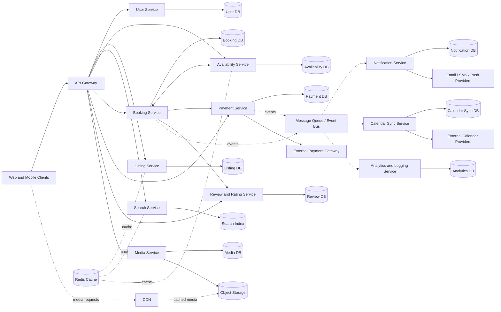

# Online Rental Platform — System Design

A high-level system design for an Airbnb-style online rental platform where users can discover rental listings, check availability, make bookings, pay securely, leave reviews, and receive notifications.

The architecture uses independently owned services and databases, synchronous APIs for request-response operations, and asynchronous events for background work and integrations.

## Table of Contents

- [Overview](#overview)
- [Architecture](#architecture)
- [Core Services](#core-services)
- [Supporting Services and Integrations](#supporting-services-and-integrations)
- [Request and Event Flows](#request-and-event-flows)
- [Data Ownership](#data-ownership)
- [Communication Patterns](#communication-patterns)
- [Caching and Media Delivery](#caching-and-media-delivery)
- [Reliability and Security Considerations](#reliability-and-security-considerations)
- [Possible Future Improvements](#possible-future-improvements)

## Overview

The platform allows guests to:

- Browse and search rental properties.
- View listing details, photos, and availability.
- Reserve a property for selected dates.
- Pay through an external payment provider.
- View booking information and receive booking updates.
- Submit reviews and ratings after a stay.

Hosts and platform operators can manage listing information and support the booking lifecycle.

### Design goals

- **Scalability:** Scale busy services, such as search, independently.
- **Service isolation:** Each service owns its domain logic and data.
- **Reliable booking:** Prevent overlapping reservations and handle payment outcomes safely.
- **Responsive discovery:** Use a search index and cache to reduce read latency.
- **Asynchronous processing:** Move notifications, analytics, and calendar synchronization off the main request path.
- **External integration:** Connect to payment gateways, calendar providers, and email/SMS/push providers.

## Architecture

The diagram represents the following high-level components:

1. **Clients:** Web and mobile applications.
2. **API Gateway:** Authentication, authorization, rate limiting, and routing.
3. **Core business services:** User, Listing, Search, Availability, Booking, Payment, Review & Rating, and Media services.
4. **Infrastructure:** Message queue/event bus, Redis cache, and object storage.
5. **Supporting services:** Notification, Calendar Sync, and Analytics & Logging.
6. **External systems:** Payment gateway, calendar providers, and email/SMS/push providers.
7. **CDN:** Delivers media content to clients.

> This Mermaid diagram is a simplified, editable representation of the architecture in the accompanying system design image. The exact deployment topology and technology choices can vary.

## Core Services

| Service | Responsibility | Data / dependency |
|---|---|---|
| **User Service** | User profiles and account-related operations. | User database |
| **Listing Service** | Creates, updates, and retrieves rental property details. | Listing database |
| **Search Service** | Searches and filters listings by location, dates, price, capacity, and other criteria. | Search index such as OpenSearch; listing data/events |
| **Availability Service** | Checks whether a property can be reserved for a date range. | Availability database |
| **Booking Service** | Coordinates reservation creation, booking state, and cancellation workflows. | Booking database; Availability and Payment services |
| **Payment Service** | Initiates payment, tracks payment state, and processes provider callbacks/webhooks. | Payment database and external payment gateway |
| **Review & Rating Service** | Stores guest reviews and listing ratings. | Review database; booking eligibility checks |
| **Media Service** | Manages photo metadata and uploads to object storage. | Media database and object storage |

### API Gateway

The API Gateway is the entry point for web and mobile clients. It can handle:

- Authentication and token validation.
- Authorization checks and request routing.
- Rate limiting and basic request validation.
- Request IDs, access logs, and API versioning.

The gateway should not contain the core business logic for bookings or payments.

## Supporting Services and Integrations

### Message Queue / Event Bus

The event bus allows services to publish events without waiting for every downstream consumer to finish. Example events include:

- `BookingRequested`
- `BookingConfirmed`
- `BookingCancelled`
- `PaymentSucceeded`
- `PaymentFailed`
- `ListingUpdated`
- `ReviewSubmitted`

Consumers can process these events independently for notifications, calendar synchronization, analytics, and other background tasks.

### Notification Service

Sends booking updates and other user communications through email, SMS, or push notification providers. It should support retries, delivery status tracking, and duplicate-event protection.

### Calendar Sync Service

Synchronizes booking and availability changes with supported external calendar providers. External synchronization should be retryable and should not block a successful internal booking.

### Analytics & Logging Service

Consumes events and operational logs for product analytics, debugging, monitoring, and reporting. Analytics processing should not slow down the booking request path.

### Payment Gateway

An external provider processes payment details. The platform stores transaction references and payment states rather than raw card data. Provider webhooks should be authenticated and processed idempotently.

## Request and Event Flows

### 1. Search for a rental

1. The client sends search criteria through the API Gateway.
2. The Search Service queries the search index.
3. Listing information and suitable availability are used to present relevant results.
4. Frequently requested or safe-to-cache data may be served from Redis.
5. The client receives matching listings and summary details.

Search results can become stale briefly, so the booking flow must re-check availability before confirming a reservation.

### 2. Create a booking

1. The client requests a booking for a property and date range.
2. The Booking Service validates the request and checks availability.
3. The platform atomically reserves the requested dates or creates a temporary hold, preventing competing bookings for the same dates.
4. The Payment Service initiates payment with the external gateway.
5. After a verified payment result, the booking is confirmed or moved to the appropriate failure/expiry state.
6. The platform emits a booking/payment event.
7. Notification, calendar, and analytics consumers process the event asynchronously.

**Important:** A simple availability read followed by a separate write is not enough to prevent double booking. Enforce date-range conflicts with an atomic database operation, constraint, lock, or equivalent concurrency-control mechanism. Define how temporary holds expire and how failed or delayed payments release inventory.

### 3. Payment processing

1. The Payment Service creates a payment attempt with a unique internal reference.
2. The external gateway processes the payment.
3. The service receives the provider response and/or webhook.
4. The service verifies the webhook, deduplicates repeated callbacks, and updates payment state.
5. The booking workflow reacts to the final payment outcome.
6. A payment event is published for downstream consumers.

Payment and booking updates span multiple services, so use a state machine and compensating actions rather than assuming a single database transaction covers the entire flow.

### 4. Upload and deliver listing photos

1. An authorized user requests a media upload.
2. The Media Service validates the request and can issue a time-limited upload URL.
3. The client uploads the file to object storage.
4. Media metadata is saved in the Media database.
5. The CDN delivers images to clients, reducing repeated origin requests and improving load times.

Validate file type and size, and consider malware scanning, image processing, and access controls where appropriate.

### 5. Reviews and ratings

1. A user submits a review for a completed stay.
2. The Review & Rating Service verifies that the user is eligible to review the booking.
3. The review is stored.
4. A `ReviewSubmitted` event can trigger rating aggregation or analytics updates.

## Data Ownership

Each service owns its database. Other services should access its data through an API or events rather than directly modifying its tables.

| Data store | Example contents |
|---|---|
| User DB | Accounts, profiles, preferences |
| Listing DB | Property descriptions, location, amenities, pricing metadata |
| Search Index | Search-optimized listing documents and filter fields |
| Availability DB | Bookable dates, inventory, holds, blocked periods |
| Booking DB | Guest, listing, dates, booking status, price snapshot |
| Payment DB | Payment attempts, provider references, status, idempotency keys |
| Review DB | Reviews, ratings, booking references |
| Media DB | Object keys, media metadata, listing associations |
| Notification DB | Notification requests, delivery state, retry information |
| Calendar Sync DB | External calendar mappings and synchronization state |
| Analytics DB | Aggregated events, metrics, and reporting data |
| Redis | Cached data and short-lived, non-authoritative values |
| Object Storage | Listing photos and other uploaded media |

The diagram labels individual databases as service-owned databases. The specific database engine for each service is an implementation choice.

## Communication Patterns

The design uses two main communication styles:

- **Synchronous HTTP/gRPC:** For operations that need an immediate response, such as fetching listing details, searching, checking availability, and initiating a booking.
- **Asynchronous events:** For work that can happen after the main request, such as notifications, analytics, and calendar synchronization.

Use timeouts, bounded retries, circuit breakers where appropriate, and clear error handling for synchronous calls. For event delivery, design consumers to tolerate duplicate messages and retry transient failures. A transactional outbox can help ensure database changes and event publication do not silently diverge.

## Caching and Media Delivery

### Redis cache

Redis can cache popular listing summaries, search results, configuration, and other suitable read-heavy data.

- Choose a clear TTL for each cached value.
- Invalidate or refresh affected entries after listing updates.
- Avoid treating cached availability as the source of truth.
- Use the authoritative booking/availability write path to prevent conflicts.

### CDN and object storage

Store image binaries in object storage and serve them through a CDN. Keep media metadata and object keys in the Media Service database. Use signed upload URLs and, when needed, signed read URLs or public CDN paths based on the platform's privacy model.

## Reliability and Security Considerations

- **Authentication and authorization:** Validate identity and check ownership/permissions for listing edits, bookings, and reviews.
- **Double-booking prevention:** Enforce availability atomically at the point of reservation.
- **Idempotency:** Make booking and payment retries safe using idempotency keys and unique request references.
- **Payment correctness:** Verify gateway webhooks, handle delayed outcomes, and reconcile payment and booking states.
- **Event reliability:** Use retries, dead-letter handling, monitoring, and idempotent consumers.
- **Data consistency:** Accept eventual consistency for search indexes, notifications, and external calendars, but keep booking confirmation dependent on authoritative reservation and payment state.
- **Privacy:** Encrypt traffic, protect secrets, minimize personal data, and apply retention/access policies to logs and user data.
- **Observability:** Use structured logs, metrics, distributed tracing, correlation IDs, and alerts for elevated booking failures or payment discrepancies.
- **Resilience:** Apply timeouts, rate limits, health checks, backups, and recovery procedures.
- **Abuse prevention:** Validate uploads, protect APIs against scraping and brute-force attempts, and monitor suspicious booking/payment activity.

## Possible Future Improvements

Depending on traffic and product requirements, the design could be extended with:

- A pricing and promotions service.
- A host onboarding and identity-verification workflow.
- A fraud/risk service for payments and bookings.
- Geospatial search and ranking improvements.
- A dedicated availability reservation/hold model with expiration.
- A saga/workflow orchestrator for multi-step booking and cancellation flows.
- Read replicas and database partitioning for high-volume workloads.
- Search-index update pipelines driven by listing events.
- Service-level objectives (SLOs), capacity estimates, and load-testing plans.

## Technology Choices Shown in the Diagram

The diagram suggests or explicitly labels these technologies:

- **OpenSearch** for the search index.
- **Redis** for caching.
- **Amazon S3** for object storage.
- **HTTP/gRPC** for synchronous service communication.
- **Message queue/event bus** for asynchronous event processing.

The diagram does not specify the exact API framework, database engines, cloud deployment platform, queue product, or orchestration platform. Those should be selected based on scale, team experience, cost, and operational needs.

---

## Project Status

This repository documents a **system design**, not necessarily a fully implemented platform. The diagram and README describe the proposed architecture and key design considerations; implementation details may evolve as requirements become clearer.
