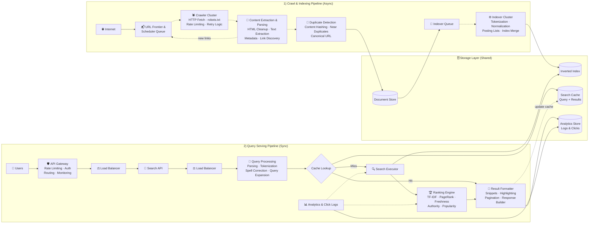
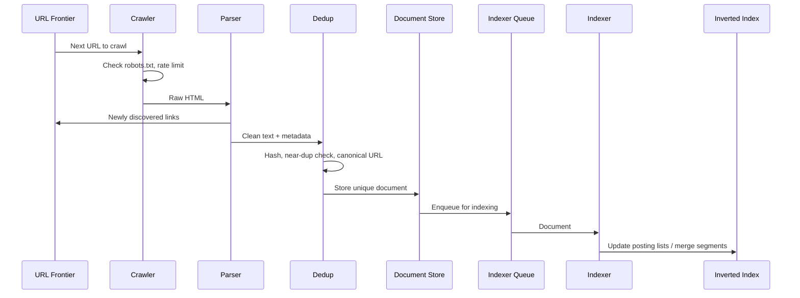
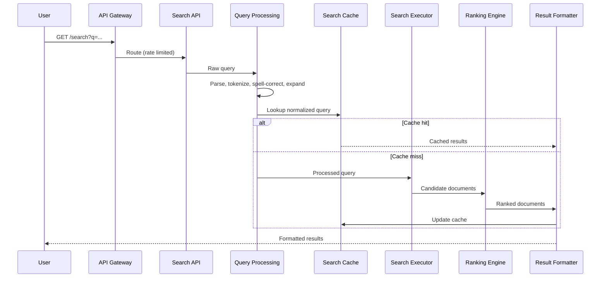

# 🔍 Search Engine — System Design

A web-scale search engine (in the spirit of Google / Bing) built from two pipelines that share a common storage layer:

1. **Crawl & Indexing Pipeline (asynchronous):** discovers, fetches, parses, deduplicates and indexes web pages.
2. **Query Serving Pipeline (synchronous):** understands a user's query, retrieves matching documents, ranks them and returns formatted results in milliseconds.

Analytics from real searches (queries, clicks, CTR) feed back into ranking so results improve over time.

---

## 📑 Table of Contents

- [Overview](#-overview)
- [Architecture Diagram](#-architecture-diagram)
- [Crawl & Indexing Pipeline](#-1-crawl--indexing-pipeline-asynchronous)
- [Query Serving Pipeline](#-2-query-serving-pipeline-synchronous)
- [Storage Layer](#-storage-layer-shared)
- [Request Flows](#-request-flows)
- [Data Model](#-data-model)
- [API Overview](#-api-overview)
- [Tech Stack](#-tech-stack)
- [Scalability & Reliability](#-scalability--reliability)
- [Security & Politeness](#-security--politeness)
- [Key Design Decisions](#-key-design-decisions)
- [Future Improvements](#-future-improvements)

---

## 🔭 Overview

| Goal | How it's achieved |
|---|---|
| Discover and keep the web fresh | URL Frontier & Scheduler with link feedback loop |
| Crawl respectfully | robots.txt compliance, per-host rate limiting, retry logic |
| Avoid wasted storage and processing | Content hashing, near-duplicate detection, canonical URLs |
| Fast retrieval over billions of pages | Inverted index with posting lists |
| Relevant results | Ranking Engine (TF-IDF, PageRank, freshness, authority, popularity) |
| Low query latency | Search cache for frequent queries, load-balanced stateless services |
| Continuously better ranking | Analytics & click logs fed into ranking models |

---

## 🗺️ Architecture Diagram



> Solid arrows = synchronous flow · Dashed arrows = asynchronous / queue

---

## 🕷️ 1) Crawl & Indexing Pipeline (Asynchronous)

### URL Frontier & Scheduler Queue
Maintains the set of URLs to crawl and decides what to fetch next.
- Prioritizes by importance (PageRank, domain authority) and freshness (how often a page changes)
- Groups URLs per host so politeness limits can be enforced
- Receives newly discovered links back from the parser (feedback loop)

### Crawler Cluster
Fleet of distributed fetchers that download pages while respecting site rules.
- **HTTP Fetch** with timeouts, redirects and compression
- **robots.txt** parsing and caching per domain
- **Rate limiting** per host to avoid overloading sites
- **Retry logic** with exponential backoff for transient failures

### Content Extraction & Parsing Cluster
Turns raw HTML into clean, searchable content.
- **HTML cleanup** — strips scripts, styles, ads and boilerplate
- **Text extraction** — main body content
- **Metadata** — title, description, language, headings, published date
- **Link discovery** — outbound links are normalized and sent back to the frontier

### Duplicate Detection Cluster
Filters duplicate content to save storage and processing.
- **Content hashing** for exact duplicates (e.g. SHA-256)
- **Near-duplicate detection** (SimHash / MinHash) for mirrored or slightly changed pages
- **Canonical URL** resolution (`rel=canonical`, URL normalization)

Unique pages are written to the **Document Store**.

### Indexer Queue
Holds documents waiting to be indexed, decoupling ingestion speed from indexing speed.

### Indexer Cluster
Builds and updates the **Inverted Index**.
- **Tokenization** — splits text into terms
- **Normalization** — lowercasing, stemming/lemmatization, stop-word handling
- **Posting lists** — for each term, the documents (and positions) it appears in
- **Index merge** — periodically merges small index segments into larger, optimized ones

---

## ⚡ 2) Query Serving Pipeline (Synchronous)

### Users
Web and mobile clients sending search queries.

### API Gateway
Rate limiting, authentication (for API clients), routing and monitoring.

### Load Balancers
Distribute traffic across stateless Search API and Query Processing instances.

### Search API
Accepts search requests, validates parameters (query, page, filters) and forwards them for processing.

### Query Processing Service
Understands the query and prepares it for search.
- **Parsing** — operators, quoted phrases, filters (`site:`, `lang:`)
- **Tokenization** — same rules as the indexer so terms match
- **Spell correction** — "did you mean…"
- **Query expansion** — synonyms and related terms

### Cache Lookup (Search Cache)
Checks whether results already exist for this normalized query.
- **Cache hit →** results go straight to the Result Formatter
- **Cache miss →** query goes to the Search Executor

### Search Executor
Searches the **Inverted Index** for matching documents, intersecting posting lists across index shards and collecting candidate documents.

### Ranking Engine
Ranks candidates by relevance and quality signals:

| Signal | Meaning |
|---|---|
| **TF-IDF / BM25** | How well the document's text matches the query terms |
| **PageRank** | Importance based on the link graph |
| **Freshness** | How recent the content is |
| **Authority signals** | Trustworthiness of the domain / source |
| **Popularity** | Click-through and engagement from analytics |

### Result Formatter
Formats and prepares results for users.
- **Snippet generation** from the document text
- **Highlighting** of matched terms
- **Pagination**
- **Response builder** — final JSON payload
- **Update cache** — stores the result set in the Search Cache for future identical queries

### Analytics & Click Logs
Collects queries, clicks, CTR, latency and more. These signals train and tune ranking models and feed popularity scoring.

---

## 🗄️ Storage Layer (Shared)

| Store | Purpose |
|---|---|
| **Document Store** | Original pages and metadata (source for indexing and snippets) |
| **Inverted Index** | Term → posting list mapping, optimized for fast search |
| **Search Cache** | Query → results, cuts latency for frequent queries |
| **Analytics Store** | Logs and clicks used to improve ranking over time |

---

## 🔁 Request Flows

### Crawling and indexing a page



### Serving a search query



---

## 🗃️ Data Model

**Document (Document Store)**
```json
{
  "docId": "d_8f3a",
  "url": "https://example.com/system-design",
  "canonicalUrl": "https://example.com/system-design",
  "title": "System Design Basics",
  "content": "Cleaned body text...",
  "language": "en",
  "contentHash": "sha256:91ab...",
  "simhash": "0x3fa2c19b7d04e811",
  "outLinks": ["https://example.com/caching"],
  "pageRank": 0.0042,
  "crawledAt": "2026-10-21T10:00:00Z"
}
```

**Posting list (Inverted Index)**
```json
{
  "term": "design",
  "docFrequency": 1820344,
  "postings": [
    { "docId": "d_8f3a", "tf": 7, "positions": [3, 18, 44] },
    { "docId": "d_19c2", "tf": 2, "positions": [11, 90] }
  ]
}
```

**Click log (Analytics Store)**
```json
{
  "queryId": "q_551",
  "query": "system design",
  "clickedDocId": "d_8f3a",
  "position": 1,
  "latencyMs": 84,
  "timestamp": "2026-10-21T12:30:00Z"
}
```

---

## 🔌 API Overview

| Method | Endpoint | Description |
|---|---|---|
| `GET` | `/search?q={query}&page={n}` | Search results (paginated) |
| `GET` | `/suggest?q={prefix}` | Autocomplete suggestions |
| `POST` | `/click` | Log a result click |
| `POST` | `/admin/urls` | Seed URLs into the frontier (internal) |

**Sample response**
```json
{
  "query": "system design",
  "correctedQuery": null,
  "page": 1,
  "totalResults": 1240000,
  "results": [
    {
      "title": "System Design Basics",
      "url": "https://example.com/system-design",
      "snippet": "Learn the fundamentals of <b>system design</b>..."
    }
  ]
}
```

---

## 🛠️ Tech Stack

| Layer | Technology (suggested) |
|---|---|
| URL Frontier / Queues | Kafka / RabbitMQ / Redis Streams |
| Crawlers | Python (Scrapy, aiohttp) / Go workers |
| Parsing | BeautifulSoup / lxml / jsoup |
| Dedup | SimHash, MinHash + LSH |
| Indexing & Search | Custom inverted index / Elasticsearch / OpenSearch / Lucene |
| Ranking | BM25, PageRank (Spark GraphX), learning-to-rank (LightGBM) |
| Document Store | HBase / Cassandra / Bigtable / S3 |
| Search Cache | Redis |
| Analytics Store | ClickHouse / BigQuery / Kafka + data lake |
| API Gateway / LB | Kong / NGINX / AWS ALB |
| Services | Node.js / Python (FastAPI) / Go |
| Observability | Prometheus, Grafana, OpenTelemetry, ELK |

---

## 📈 Scalability & Reliability

- **Async crawl pipeline:** queues between every stage let each cluster scale independently.
- **Sharded inverted index:** documents partitioned across shards; queries fan out and results are merged.
- **Index replicas:** each shard has replicas for throughput and fault tolerance.
- **Segment-based indexing:** new documents are written to small segments and merged in the background, so search stays online during updates.
- **Search cache:** frequent queries skip retrieval and ranking entirely.
- **Stateless serving tier** behind load balancers, auto-scaled on traffic.
- **Recrawl scheduling** based on page change frequency keeps the index fresh.
- **Retries, backoff and dead-letter queues** for failed fetches.

---

## 🔒 Security & Politeness

- Respects `robots.txt`, crawl-delay and `noindex` directives
- Per-host rate limiting; identifiable crawler User-Agent
- API Gateway rate limiting and auth for API clients
- Spam / SEO-abuse detection and low-quality page filtering
- Safe-search filtering for explicit content
- Query logs anonymized and retained under a privacy policy
- TLS for all external traffic

---

## ⚖️ Key Design Decisions

| Decision | Why |
|---|---|
| **Separate async and sync pipelines** | Crawling is slow and bursty; querying must be fast and predictable |
| **URL Frontier with feedback loop** | Continuously discovers the web from newly found links |
| **Dedup before storage** | Large share of the web is duplicate; filtering early saves storage and indexing |
| **Inverted index** | Lets you find all documents containing a term without scanning documents |
| **Indexer Queue** | Absorbs ingestion spikes so indexing runs at a steady rate |
| **Query/results cache** | Search traffic is heavily skewed toward popular queries |
| **Multi-signal ranking** | Text relevance alone is easy to game; link, freshness and engagement signals improve quality |
| **Click feedback loop** | Real user behavior continuously tunes ranking |

---

## 🚀 Future Improvements

- Semantic / vector search with embeddings (hybrid BM25 + dense retrieval)
- Learning-to-rank models trained on click data
- Autocomplete and query suggestions
- Personalization based on location and history
- Image, video and news verticals
- Knowledge panels and featured snippets
- Real-time indexing for news and fast-changing pages

---

## 📄 License

MIT
