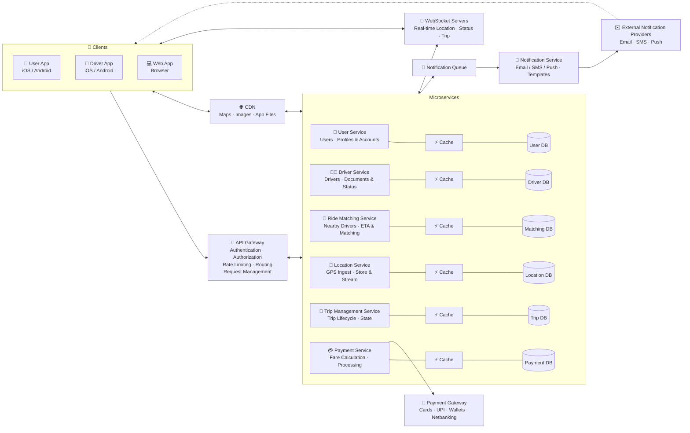
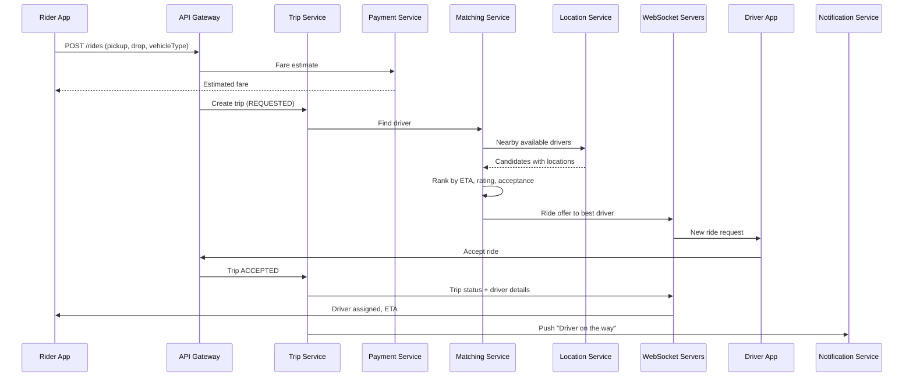
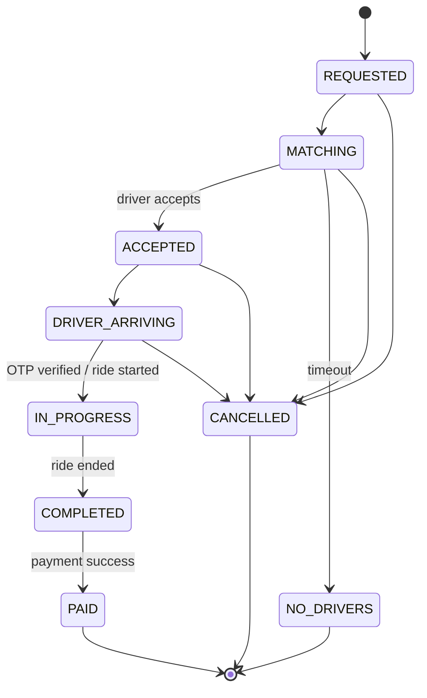

# 🚕 Ride-Hailing App — System Design

A scalable, real-time ride-hailing platform (in the spirit of Uber / Ola / Lyft). Riders request trips, nearby drivers are matched in seconds, live locations stream over WebSockets, and fares are calculated and paid at the end of the trip. The platform is built as microservices, each with its own cache and database, behind a single API gateway.

---

## 📑 Table of Contents

- [Overview](#-overview)
- [Architecture Diagram](#-architecture-diagram)
- [Core Components](#-core-components)
- [Request Flows](#-request-flows)
- [Trip Lifecycle](#-trip-lifecycle)
- [Data Model](#-data-model)
- [API Overview](#-api-overview)
- [WebSocket Events](#-websocket-events)
- [Tech Stack](#-tech-stack)
- [Scalability & Reliability](#-scalability--reliability)
- [Security](#-security)
- [Key Design Decisions](#-key-design-decisions)
- [Future Improvements](#-future-improvements)

---

## 🔭 Overview

| Goal | How it's achieved |
|---|---|
| Match riders with nearby drivers fast | Ride Matching Service with geospatial search on live driver locations |
| Track drivers in real time | Location Service ingests GPS updates; WebSocket servers push them to clients |
| Reliable trip state | Trip Management Service with an explicit state machine |
| Accurate fares and smooth payments | Payment Service (fare calculation) + external payment gateway (Cards, UPI, Wallets, Netbanking) |
| Fast loading of maps and app assets | CDN for static assets |
| Keep riders and drivers informed | Notification queue + Notification Service → Email / SMS / Push providers |
| Independent scaling | Microservices, each with its own cache and database |

---

## 🗺️ Architecture Diagram



---

## 🧩 Core Components

### 1. Clients
- **User App (iOS / Android):** request rides, see fare estimates, track the driver live, pay and rate.
- **Driver App (iOS / Android):** go online/offline, send GPS updates every few seconds, accept or reject requests, navigate and complete trips.
- **Web App (Browser):** booking and account management from the browser; also used for admin/ops dashboards.

### 2. CDN
Serves static assets — map tiles, images (profile photos, vehicle images) and app files — from edge locations for fast loading.

### 3. API Gateway
Single entry point for all REST traffic.
- **Authentication** — JWT / OAuth token validation
- **Authorization** — rider vs driver vs admin permissions
- **Rate limiting** — protects against abuse and request floods
- **Routing** — forwards requests to the correct microservice
- **Request management** — validation, timeouts, retries

### 4. User Service
Manages rider accounts, profiles, saved places and preferences. *(Cache + User DB)*

### 5. Driver Service
Manages driver onboarding, documents (license, vehicle, insurance), verification and status (`OFFLINE`, `AVAILABLE`, `ON_TRIP`). *(Cache + Driver DB)*

### 6. Ride Matching Service
The heart of the system.
- Finds **nearby available drivers** using geospatial lookups on live locations
- Computes **ETA** to pickup
- Applies **matching logic** — distance, ETA, rating, acceptance rate, vehicle type
- Sends offers to drivers one at a time (or in small batches) with a timeout before moving to the next

*(Cache + Matching DB)*

### 7. Location Service
- **Ingests GPS updates** from driver apps (every 3–5 seconds)
- **Stores** the latest position in a fast geospatial cache (e.g. Redis GEO / H3 / geohash cells)
- **Streams** locations to WebSocket servers for live tracking
- Persists location history for trip routes and analytics

*(Cache + Location DB)*

### 8. Trip Management Service
Owns the **trip lifecycle and state management** — from request through matching, pickup, ride, completion or cancellation. Enforces valid state transitions so a trip can never be in two conflicting states. *(Cache + Trip DB)*

### 9. Payment Service
- **Fare calculation** — base fare + distance + time + surge + tolls − discounts
- **Payment processing** through the external payment gateway
- Handles refunds, receipts and driver payouts

*(Cache + Payment DB)*

### 10. Payment Gateway (External)
Processes Cards, UPI, Wallets and Netbanking (e.g. Razorpay / Stripe / Paytm). Results come back via signed webhooks.

### 11. WebSocket Servers
Persistent connections with clients for **real-time updates**: driver location, trip status changes and ride offers. Microservices publish updates here instead of clients polling.

### 12. Notification Queue
Buffers notification jobs so services never wait on slow external providers.

### 13. Notification Service
Consumes the queue and sends **Email / SMS / Push** using **templates** (ride confirmed, driver arriving, receipt, OTP).

### 14. External Notification Providers
Email, SMS and Push delivery (e.g. SendGrid, Twilio / MSG91, Firebase Cloud Messaging / APNs).

---

## 🔁 Request Flows

### Request a ride and get matched



1. Rider enters pickup and drop; the Payment Service returns a fare estimate.
2. Trip Management Service creates a trip in `REQUESTED` state.
3. Ride Matching queries the Location Service for available drivers near the pickup.
4. Candidates are ranked by ETA, distance, rating and acceptance rate.
5. The best driver receives the offer over WebSocket; if they decline or time out, the next driver is tried.
6. On accept, the trip moves to `ACCEPTED` and the rider sees driver details and ETA in real time.

### Live tracking during the trip
1. Driver App sends GPS updates every few seconds → **Location Service**.
2. Location Service updates the geospatial cache and forwards positions to **WebSocket Servers**.
3. WebSocket Servers push the driver's position to the rider's app.

### Complete the trip and pay
1. Driver ends the trip → Trip Service moves it to `COMPLETED`.
2. Payment Service calculates the final fare from the actual route, time and surge.
3. Payment is charged via the **Payment Gateway** (or marked as cash).
4. A receipt is sent through the **Notification Service**; rider and driver rate each other.

---

## 🔄 Trip Lifecycle



---

## 🗃️ Data Model

**User**
```json
{
  "userId": "u_42",
  "name": "Dhiti Varma",
  "phone": "+91XXXXXXXXXX",
  "rating": 4.9,
  "savedPlaces": [{ "label": "Home", "lat": 19.076, "lng": 72.8777 }]
}
```

**Driver**
```json
{
  "driverId": "d_17",
  "name": "Ravi",
  "vehicle": { "type": "SEDAN", "number": "MH01AB1234", "model": "Swift Dzire" },
  "status": "AVAILABLE",
  "rating": 4.8,
  "documentsVerified": true
}
```

**Driver location (cache)**
```json
{
  "driverId": "d_17",
  "lat": 19.0728,
  "lng": 72.8826,
  "geohash": "te7ud2",
  "heading": 87,
  "updatedAt": "2026-10-23T17:42:05Z"
}
```

**Trip**
```json
{
  "tripId": "t_9001",
  "riderId": "u_42",
  "driverId": "d_17",
  "pickup": { "lat": 19.076, "lng": 72.8777 },
  "drop": { "lat": 19.1136, "lng": 72.8697 },
  "vehicleType": "SEDAN",
  "status": "IN_PROGRESS",
  "otp": "4821",
  "requestedAt": "2026-10-23T17:40:00Z"
}
```

**Payment**
```json
{
  "paymentId": "pay_555",
  "tripId": "t_9001",
  "fare": { "base": 50, "distance": 140, "time": 35, "surge": 1.2, "total": 270 },
  "method": "UPI",
  "status": "SUCCESS"
}
```

---

## 🔌 API Overview

| Method | Endpoint | Service | Description |
|---|---|---|---|
| `POST` | `/auth/login` | User | OTP / password login, returns JWT |
| `GET` | `/users/me` | User | Rider profile |
| `POST` | `/drivers/status` | Driver | Go online / offline |
| `POST` | `/locations` | Location | Driver GPS update (or via WebSocket) |
| `POST` | `/fare/estimate` | Payment | Fare estimate for pickup → drop |
| `POST` | `/rides` | Trip | Request a ride |
| `POST` | `/rides/{id}/accept` | Trip | Driver accepts a ride |
| `POST` | `/rides/{id}/start` | Trip | Start ride (OTP verified) |
| `POST` | `/rides/{id}/complete` | Trip | End ride |
| `POST` | `/rides/{id}/cancel` | Trip | Cancel ride |
| `GET` | `/rides/{id}` | Trip | Trip details and status |
| `POST` | `/payments` | Payment | Pay for a trip |
| `POST` | `/payments/webhook` | Payment | Payment gateway callback |
| `POST` | `/rides/{id}/rating` | Trip | Rate rider / driver |

---

## 📡 WebSocket Events

| Event | Direction | Payload |
|---|---|---|
| `driver.location` | Driver → Server | `{ lat, lng, heading }` |
| `ride.offer` | Server → Driver | Trip summary, pickup, fare, expiry |
| `ride.assigned` | Server → Rider | Driver, vehicle, ETA |
| `driver.location.update` | Server → Rider | Live driver position |
| `trip.status` | Server → Both | New trip state |
| `trip.cancelled` | Server → Both | Who cancelled and why |

---

## 🛠️ Tech Stack

| Layer | Technology (suggested) |
|---|---|
| Mobile apps | React Native / Flutter / Kotlin / Swift |
| Web app | React / Next.js |
| API Gateway | Kong / NGINX / AWS API Gateway |
| Services | Node.js / Go / Python (FastAPI) microservices |
| Real-time | WebSocket servers (Socket.IO / ws), Redis Pub/Sub |
| Geospatial | Redis GEO, Uber H3, geohash, PostGIS |
| Caches | Redis |
| Databases | PostgreSQL (users, drivers, trips, payments), Cassandra (location history) |
| Queues | Kafka / RabbitMQ / AWS SQS |
| Maps & routing | Google Maps / Mapbox / OSRM |
| Payments | Razorpay / Stripe / Paytm |
| Notifications | FCM / APNs, Twilio / MSG91, SendGrid |
| CDN | CloudFront / Cloudflare |
| Deployment | Docker, Kubernetes |
| Observability | Prometheus, Grafana, OpenTelemetry, ELK |

---

## 📈 Scalability & Reliability

- **Geo-sharding:** locations and matching are partitioned by city / geohash cell, so each shard handles a bounded area.
- **Write-heavy location ingest:** only the latest position is kept in the hot cache; history is written asynchronously.
- **Horizontally scaled WebSocket servers** with a pub/sub layer (Redis / Kafka) to route messages to the right connection.
- **Driver locking during matching:** a driver is locked when an offer is sent, so two riders can't be matched to the same driver.
- **Idempotent trip transitions and payments** so retries never double-book or double-charge.
- **Surge pricing** computed per area from supply/demand to balance the marketplace.
- **Async notifications** via a queue, with retries and dead-letter handling.
- **Circuit breakers and timeouts** around maps, payment and notification providers.
- **Multi-AZ deployment** and database replicas for high availability.

---

## 🔒 Security

- JWT / OAuth authentication and role-based authorization at the API Gateway
- OTP-verified ride start to confirm the right rider and driver
- Driver background and document verification
- Rate limiting against fake ride requests and abuse
- Phone number masking between rider and driver
- SOS / emergency button and trip sharing
- Payment card data handled only by the PCI-compliant gateway; webhook signatures verified
- TLS for REST and WebSocket (WSS); encryption at rest for databases

---

## ⚖️ Key Design Decisions

| Decision | Why |
|---|---|
| **Microservices with cache + DB each** | Each domain scales and fails independently |
| **Dedicated Location Service** | GPS ingest is extremely write-heavy and needs its own scaling |
| **Geospatial indexing (geohash / H3)** | Finding nearby drivers is fast without scanning every driver |
| **WebSockets for real-time** | Live tracking and ride offers need push, not polling |
| **Explicit trip state machine** | Prevents invalid transitions and inconsistent trips |
| **Notification queue** | Slow third-party providers never block trip flows |
| **External payment gateway** | Supports UPI, cards, wallets and netbanking without handling card data |
| **CDN for static assets** | Faster app and map loads, less load on backend |

---

## 🚀 Future Improvements

- Ride pooling / shared rides
- Scheduled rides
- ML-based ETA prediction and demand forecasting
- Dynamic surge pricing models
- In-app chat and masked calling
- Driver earnings and incentives dashboard
- Fraud detection (GPS spoofing, fake trips)
- Multi-city / multi-country rollout with localized pricing

---

## 📄 License

MIT
