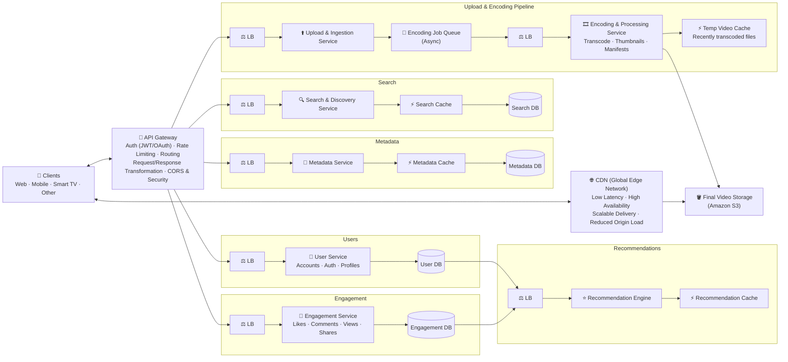
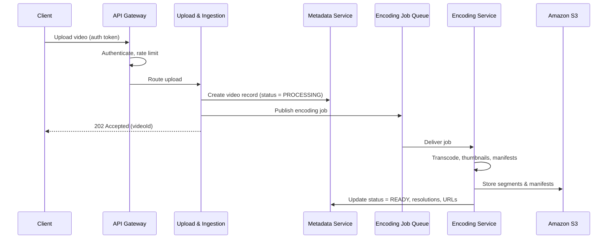

# 🎬 Video Sharing Platform — System Design

A scalable video sharing platform (in the spirit of YouTube / Vimeo). Users upload videos that are transcoded asynchronously into multiple resolutions, stored durably in object storage, streamed worldwide through a CDN, and surfaced through search, engagement and personalized recommendations.

---

## 📑 Table of Contents

- [Overview](#-overview)
- [Architecture Diagram](#-architecture-diagram)
- [Core Components](#-core-components)
- [Request Flows](#-request-flows)
- [Data Model](#-data-model)
- [API Overview](#-api-overview)
- [Tech Stack](#-tech-stack)
- [Scalability & Reliability](#-scalability--reliability)
- [Security](#-security)
- [Key Design Decisions](#-key-design-decisions)
- [Future Improvements](#-future-improvements)

---

## 🔭 Overview

| Goal | How it's achieved |
|---|---|
| Accept large uploads reliably | Dedicated Upload & Ingestion Service, resumable uploads |
| Don't block users while videos process | Asynchronous Encoding Job Queue |
| Play smoothly on any device and network | Transcoding to multiple resolutions + adaptive bitrate manifests |
| Low-latency global playback | CDN (global edge network) in front of Amazon S3 |
| Fast reads for metadata, search, recommendations | Dedicated Redis caches per service |
| Independent scaling | Microservices, each behind its own load balancer |
| Personalized feeds | Recommendation Engine fed by user and engagement data |

---

## 🗺️ Architecture Diagram



---

## 🧩 Core Components

### 1. Clients
Web, mobile, smart TV and other devices. Clients upload videos through the API and stream playback directly from the CDN using adaptive bitrate (HLS / DASH).

### 2. API Gateway
Single entry point for all API traffic.
- **Authentication** — JWT / OAuth token checks
- **Rate limiting** per user / per client
- **Routing** to the correct service's load balancer
- **Request/response transformation** — payload shaping per client type
- **CORS & security** — headers, input validation, WAF rules

### 3. Load Balancers
Every service sits behind its own load balancer, so each one scales horizontally and independently, with health checks removing unhealthy instances.

### 4. Upload & Ingestion Service
Receives raw video uploads (ideally chunked / resumable, or via pre-signed S3 URLs), validates format and size, stores the raw file, creates a metadata record with status `PROCESSING`, and publishes an encoding job.

### 5. Encoding Job Queue (Asynchronous)
Decouples upload from processing. Uploads return immediately while transcoding — which is slow and CPU/GPU heavy — happens in the background. Supports retries and dead-letter handling for failed jobs.

### 6. Encoding & Processing Service
Worker fleet that consumes encoding jobs:
- **Transcoding** into multiple resolutions and bitrates (e.g. 240p → 4K)
- **Thumbnail** generation
- **Manifest** generation (HLS `.m3u8` / DASH `.mpd`) for adaptive streaming
- Writes final outputs to **Amazon S3** and marks the video `READY`

**Temporary Video Storage (Cache):** keeps recently transcoded files close to the encoders for retries, post-processing and fast hand-off.

### 7. Final Video Storage (Amazon S3)
Durable source of truth for transcoded segments, manifests and thumbnails. Lifecycle rules move rarely watched content to cheaper tiers.

### 8. Content Delivery Network (CDN)
Global edge network serving video segments and thumbnails.
- ✅ Low latency
- ✅ High availability
- ✅ Scalable delivery
- ✅ Reduced origin load

Popular videos are served almost entirely from edge caches; misses are pulled from S3.

### 9. Metadata Service
Manages video info — title, description, tags, uploader, duration, status, available resolutions and storage locations. Reads go through a **Metadata Cache** before the **Metadata Database**.

### 10. User Service
Handles accounts, authentication and profiles, backed by the **User Database**.

### 11. Engagement Service
Records likes, comments, views and shares in the **Engagement Database**. High-volume counters (views, likes) can be buffered and aggregated before writing.

### 12. Search & Discovery Service
Indexes video metadata for full-text search, filters and trending discovery, with a **Search Cache** in front of the **Search Database**.

### 13. Recommendation Engine Service
Combines user profiles and engagement signals to personalize home feeds and "up next" suggestions. Results are precomputed and served from the **Recommendation Cache**.

---

## 🔁 Request Flows

### Upload a video



1. Client uploads through the API Gateway (authenticated, rate limited).
2. Upload & Ingestion Service stores the raw file and creates a metadata record.
3. An encoding job is pushed to the queue and the client gets an immediate response.
4. Encoding workers transcode the video into multiple renditions, create thumbnails and manifests.
5. Outputs land in S3; metadata is updated to `READY` and the video becomes watchable.

### Watch a video
1. Client requests video details → **Metadata Service** (cache first, then DB).
2. Response contains the manifest URL on the **CDN**.
3. Player downloads the manifest and fetches segments from the nearest edge, switching bitrate based on bandwidth.
4. CDN misses are fetched from **Amazon S3** and cached at the edge.
5. A view event is sent to the **Engagement Service**.

### Search
1. Client sends a query → **Search & Discovery Service**.
2. Popular queries are answered from the **Search Cache**; otherwise from the **Search Database** index.

### Personalized feed
1. Client requests home feed → **Recommendation Engine**.
2. Precomputed recommendations are served from the **Recommendation Cache**.
3. The engine periodically refreshes them using **User DB** and **Engagement DB** signals.

---

## 🗃️ Data Model

**Video metadata**
```json
{
  "videoId": "v_123",
  "uploaderId": "u_42",
  "title": "System Design in 10 Minutes",
  "description": "A quick walkthrough...",
  "tags": ["system design", "backend"],
  "durationSec": 612,
  "status": "READY",
  "renditions": ["240p", "480p", "720p", "1080p"],
  "manifestUrl": "https://cdn.example.com/v_123/master.m3u8",
  "thumbnailUrl": "https://cdn.example.com/v_123/thumb.jpg",
  "createdAt": "2026-10-21T10:00:00Z"
}
```

**User**
```json
{
  "userId": "u_42",
  "username": "dhiti",
  "email": "user@example.com",
  "subscriptions": ["u_7", "u_99"],
  "createdAt": "2026-01-15T08:00:00Z"
}
```

**Engagement event**
```json
{
  "eventId": "e_9001",
  "userId": "u_42",
  "videoId": "v_123",
  "type": "LIKE",
  "createdAt": "2026-10-21T12:30:00Z"
}
```

**Video status lifecycle:** `UPLOADING → PROCESSING → READY` (or `FAILED`)

---

## 🔌 API Overview

| Method | Endpoint | Description |
|---|---|---|
| `POST` | `/videos` | Start an upload, returns `videoId` / upload URL |
| `GET` | `/videos/{id}` | Video metadata and manifest URL |
| `PATCH` | `/videos/{id}` | Update title, description, tags |
| `DELETE` | `/videos/{id}` | Delete a video |
| `POST` | `/videos/{id}/like` | Like a video |
| `POST` | `/videos/{id}/comments` | Add a comment |
| `GET` | `/videos/{id}/comments` | List comments (paginated) |
| `GET` | `/search?q=` | Search videos |
| `GET` | `/feed` | Personalized recommendations |
| `POST` | `/auth/login` | Log in, returns JWT |
| `GET` | `/users/{id}` | User profile |

---

## 🛠️ Tech Stack

| Layer | Technology (suggested) |
|---|---|
| Clients | React / Next.js (web), React Native (mobile), TV apps |
| API Gateway | AWS API Gateway / Kong / NGINX |
| Load Balancing | AWS ALB / NGINX / Envoy |
| Services | Node.js / Python (FastAPI) microservices |
| Encoding Queue | Kafka / RabbitMQ / AWS SQS |
| Transcoding | FFmpeg workers, AWS Elemental MediaConvert |
| Streaming formats | HLS / MPEG-DASH |
| Object Storage | Amazon S3 |
| CDN | CloudFront / Cloudflare / Akamai |
| Caches | Redis |
| Metadata / Engagement DB | Cassandra / DynamoDB / MongoDB |
| User DB | PostgreSQL / MySQL |
| Search | Elasticsearch / OpenSearch |
| Recommendations | Spark / Python ML pipeline (collaborative filtering, embeddings) |
| Observability | Prometheus, Grafana, OpenTelemetry, ELK |

---

## 📈 Scalability & Reliability

- **Independent scaling:** each service has its own load balancer and auto-scaling group.
- **Async encoding:** the queue absorbs upload spikes; encoding workers scale on queue depth.
- **CDN-first delivery:** most playback traffic never reaches the origin.
- **Caching everywhere:** metadata, search, recommendations and recently transcoded files.
- **Database sharding** by `videoId` / `userId`; read replicas for read-heavy data.
- **Counter aggregation:** views and likes are batched to avoid write hot spots on viral videos.
- **Retries & dead-letter queues** for failed encoding jobs.
- **Multi-AZ deployments** and S3 durability for fault tolerance.

---

## 🔒 Security

- JWT / OAuth authentication at the API Gateway
- Rate limiting and throttling against abuse and scraping
- CORS policies and security headers enforced at the gateway
- TLS everywhere; server-side encryption for S3
- Signed, expiring CDN URLs for private or unlisted videos
- Upload validation (file type, size, malware scanning)
- Optional DRM (Widevine / FairPlay) for premium content

---

## ⚖️ Key Design Decisions

| Decision | Why |
|---|---|
| **Asynchronous encoding queue** | Transcoding is slow and expensive; users shouldn't wait on it |
| **Multiple renditions + adaptive bitrate** | Smooth playback across devices and network conditions |
| **CDN in front of S3** | Low latency worldwide and far less load on origin storage |
| **Load balancer per service** | Scale and fail independently |
| **Database per service** | Loose coupling; each store fits its access pattern |
| **Dedicated caches** | Read-heavy workloads (metadata, search, feeds) stay fast |
| **Precomputed recommendations** | Feeds load instantly instead of computing per request |

---

## 🚀 Future Improvements

- Live streaming (RTMP ingest, low-latency HLS)
- Content moderation (automated + human review)
- Auto-generated captions and subtitles
- Analytics dashboard for creators
- Monetization: ads, subscriptions, memberships
- Multi-region active-active deployment
- Notifications for new uploads from subscribed channels

---

## 📄 License

MIT
